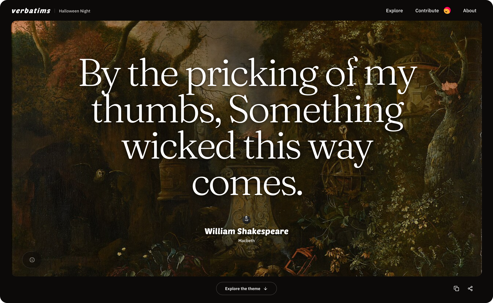
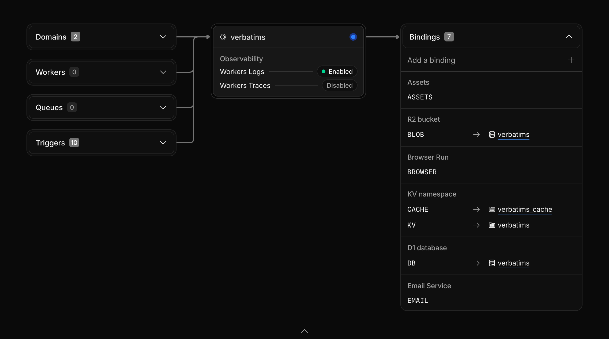

<div align="center">
  
  <p><strong>Share memorable quotes with their sources.</strong></p>
  <p><a href="https://verbatims.cc">Visit verbatims.cc</a> · <a href="https://verbatims.cc/api/v1/docs">Explore the API</a> · <a href="https://verbatims.cc/about">About the project</a></p>
  
</div>

Verbatims is a multilingual quote library for readers, researchers and curious minds. Browse quotes from books, films and more; follow their attributions to authors and references; and save or share the lines that stay with you.

## Explore and contribute

| Find | Keep | Share | Improve |
| --- | --- | --- | --- |
| Search quotes by text, author, reference or tag. Browse in English or French. | Save favourites and organise quotes into personal collections. | Copy attributed text or create an image to share. | Submit quotes and report corrections; submissions go through moderation. |

Quotes connect to authors, references and tags, so you can follow a line back to its context. The API also provides programmatic access to quotes and related catalogue data.

## Built with

| Area | Technology |
| --- | --- |
| Application | Nuxt 4, Vue 3 and TypeScript |
| Interface | UnaUI and UnoCSS |
| State and utilities | Pinia and VueUse |
| Data access | Drizzle ORM with SQLite / Cloudflare D1 |
| Production platform | Cloudflare Workers, with NuxtHub storage integrations |
| Authentication | `nuxt-auth-utils` and role-based access |

The project uses file-based server routes in `server/api/`, shared domain types in `shared/types/`, and numbered SQLite migrations in `server/db/migrations/sqlite/`.

### Cloudflare deployment

The production Worker connects to Cloudflare's storage and platform services through bindings:

<p align="center">
  
</p>

## Run it locally

**Requirements:** A Node.js version supported by Nuxt. Use npm (included with Node.js), or install [Bun](https://bun.sh/) as an alternative package manager.

```bash
git clone https://github.com/rootasjey/verbatims.git
cd verbatims
npm install
npm run db:migrate
npm run dev
```

Open [http://localhost:3002](http://localhost:3002). The `dev` command checks the local database setup with Node.js before starting Nuxt. You can use Bun instead by replacing `npm install` with `bun install` and `npm run` with `bun run`.

Local development uses the file-backed database at `.data/db/sqlite.db` through NuxtHub's `libsql` driver. Production uses the Cloudflare D1 binding. Migrations are not applied automatically in development, so run `bun run db:migrate` after pulling schema changes.

> `bun run db:sync-prod` replaces the local database with a production-data copy after creating a backup. Use it only when you intend to refresh local data.

## Useful commands

| Command | What it does |
| --- | --- |
| `bun run dev` | Start the local app on port `3002` (runs the database precheck first). |
| `bun run db:check` | Regenerate and verify NuxtHub's local database client. |
| `bun run db:migrate` | Apply pending migrations to the local SQLite database. |
| `bun run db:sync-prod` | Back up, then refresh the local database from production. |
| `bun run typecheck` | Run Nuxt and TypeScript checks. |
| `bun run test` | Run the Vitest suite. |
| `bun run preview` | Preview a production build locally. |

## API

The versioned API supports quotes, authors, references, tags, collections and search. API keys are managed from the developer dashboard; most endpoints require a key with the appropriate permissions.

```bash
curl 'https://verbatims.cc/api/v1/quotes?limit=5&language=en' \
  -H "Authorization: Bearer $VERBATIMS_API_KEY"
```

See the [interactive API reference](https://verbatims.cc/api/v1/docs) or the in-app [developer guide](https://verbatims.cc/developers) for authentication, parameters and response formats.

## SDK and CLI

The API can also be used from TypeScript or the terminal. The [Verbatims SDK and CLI repository](https://github.com/rootasjey/verbatims-sdk) contains the typed `@verbatims/sdk` client, an optional Nuxt module, and the `@verbatims/cli` command-line tool.

```bash
npm install @verbatims/sdk
npm install -g @verbatims/cli

verbatims config
verbatims search "courage" --type quotes
```

The SDK covers quotes, authors, references, collections, search and more. The CLI provides commands for browsing and managing API resources. See the repository's [SDK guide](https://github.com/rootasjey/verbatims-sdk#readme) and [CLI guide](https://github.com/rootasjey/verbatims-sdk/tree/main/packages/cli) for options and examples.

## Project notes

- **Languages:** English and French, with locale files in `locales/`.
- **Data and corrections:** The project aims to preserve attribution and source context. Readers can report issues from the app; quotes are reviewed before publication.
- **Privacy:** See the [privacy policy](https://verbatims.cc/privacy) and [terms](https://verbatims.cc/terms).
- **Admin and operations:** Operational guides live in [`docs/admin/`](docs/admin/) and [`docs/operations/`](docs/operations/).
- **Design explorations:** Archived homepage and quote-page prototypes are in [`docs/design/archive/`](docs/design/archive/).

## Contributing

Bug reports, corrections and focused pull requests are welcome. Please keep changes consistent with the existing TypeScript, UnaUI and UnoCSS patterns, and include context for user-facing changes.

## License

Verbatims is released under the [MIT License](LICENSE).
