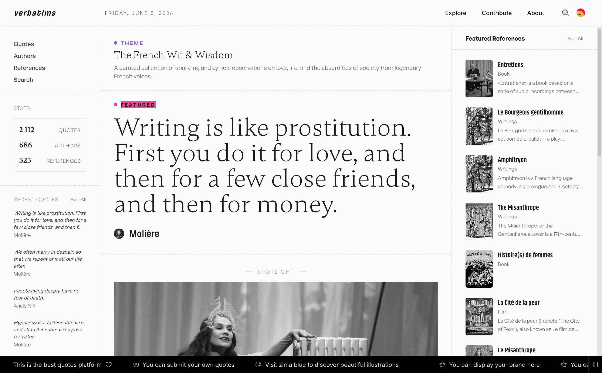

> ### verbatims is a quote platform and service for discovering, curating, and sharing timeless words, with moderation and admin workflows.

💬 [verbatims.cc](https://verbatims.cc)

## Overview

verbatims brings quotes, sources, and context together in one place. Browse by topic or author, build personal collections, and quickly share cleanly attributed quotes. The project focuses on accuracy, thoughtful curation, and a pleasant reading experience.

Key ideas:
- Delightful discovery with fast search and smart ranking
- Accurate attribution with references to primary sources where possible
- Community submissions with moderation for quality and clarity
- Clean sharing: copy attribution-ready text or export visuals

## Features

- Browse and search by topic, author, keyword, or reference
- Save favorites and build collections
- Contribute quotes with sources (moderation workflow)
- Report issues (typos, attribution, duplicates)
- Share formatted quote cards or copy clean text with attribution
- Accessible UI: keyboard navigation, high contrast, screen-reader labels

## Tech stack

- Nuxt 4 (Vue 3) for the application framework and SSR
- Pinia for state management
- UnaUI + UnoCSS for UI primitives and utility-first styling
- Nuxt Image for image handling and optimization
- Cloudflare D1/SQLite for database and deployment on Cloudflare Workers
- Drizzle ORM for type-safe database queries
- Auth via `nuxt-auth-utils` (role-based: user, moderator, admin)

See exact versions in `package.json` and configuration in `nuxt.config.ts`.

## Architecture

- Frontend: Nuxt 4 with SSR/SPA hybrid
- Database: Cloudflare D1 (SQLite) via Drizzle ORM
- API: File-based routes under `server/api/*`
- Auth: `getUserSession(event)` on server, `useUserSession()` on client
- State: Pinia stores for global state and preferences
- Deployment: Cloudflare Workers

Helpful references:
- Schema: `server/db/migrations/schema.sql`
- Types: `types/` (e.g., `Quote`, `QuoteWithRelations`)
- Layouts: `layouts/` (`admin.vue`, `dashboard.vue`, `default.vue`)
- Admin pages: `pages/admin/*`
- Composables: `composables/` (e.g., `useDataExport.ts`)

## Getting started

Prerequisites: Node 18+ and your preferred package manager. The project uses Bun by default, but npm/pnpm/yarn work too.
NOTE: You can use any package manager, just replace `bun` with `npm`/`pnpm`/`yarn` in the commands below.

```bash
bun install        # Install dependencies
bun run dev        # Start the dev server at http://localhost:3000
bun run build      # Build for production
bun run preview    # Preview the production build locally
```

Local development uses one file-backed SQLite database: `.data/db/sqlite.db` through the
NuxtHub `libsql` driver. Production continues to use the Cloudflare D1 binding. The SQL
schema lives in `server/db/migrations/schema.sql` and numbered migrations live in
`server/db/migrations/sqlite/`.

Before `bun run dev`, the `predev` check runs `nuxi prepare` and verifies that the generated
NuxtHub client still uses `libsql` and `.data/db/sqlite.db`. It fails rather than starting
against the D1 emulator if the generated configuration drifts.

## Scripts

The most common scripts are:
NOTE: You can use any package manager, just replace `bun` with `npm`/`pnpm`/`yarn` in the commands below.

- `bun run dev` - start development server
- `bun run db:check` - regenerate and verify the local NuxtHub database driver
- `bun run db:migrate` - apply pending migrations to `.data/db/sqlite.db`
- `bun run db:sync-prod` - replace `.data/db/sqlite.db` with a backup of production data
- `bun run build` - production build
- `bun run preview` - preview the production build

Note: The legacy local CLI utilities under `scripts/` have been removed. Admin operations are now performed through the in-app Admin pages and server APIs (e.g., export, import, backup).

## Localization

The project uses `nuxt-i18n-micro` with English and French translations.

Locale files live in `locales/` (root translations + page-specific files under `locales/pages/`).
The module generates a dynamic server handler `/_locales/:page/:locale/data.json` to serve translations at runtime.

### Build note (avoid OOM)

The i18n config sets `prerenderRoutes: false` in `nuxt.config.ts`. This is intentional and safe:

- The project uses the `cloudflare-module` Nitro preset (SSR), not SSG. Translation data is served at runtime by the dynamic handler described above, so pre-rendering static JSON files during the build is unnecessary.
- Skipping pre-render prevents memory spikes during the Nitro bundling step, which otherwise processes ~114 locale routes (57 page names × 2 locales) and can trigger `FATAL ERROR: Reached heap limit Allocation failed` on memory-constrained CI environments.

If you later switch to a static target, set `prerenderRoutes: true` (or remove the override) to restore static locale payloads.

## Data, privacy, and contributions

- Submissions are verified for wording and authorship before publishing; misattributions may be corrected or declined.
- Community reports with citations are encouraged.
- We store only what's needed to run the app (account info, favorites, collections, preferences). We don't sell personal data.
- See in-app pages for details: `/privacy` and `/terms`.

## Deployment

This app targets Cloudflare Workers. 
Follow Nuxt's deployment docs and the Cloudflare Workers guide. 
CI typically runs `nuxt build` and deploys the output using Cloudflare tooling.

## Contributing

Issues and PRs are welcome. Please follow the established code style (TypeScript, strict types, UnoCSS utilities, UnaUI components) and keep UI accessible.

## License

This project is licensed under the MIT License - see `LICENSE`.

## Admin documentation

Internal/operational documentation is available in `docs/admin/`:

- **OG Image Generation** – dynamic OG images, caching, and admin cache controls → [`docs/admin/OG_IMAGE_GENERATION.md`](docs/admin/OG_IMAGE_GENERATION.md)
- **Automated Social Posting** – social queue, provider config, scheduling, Meta reconnect flow → [`docs/admin/SOCIAL_AUTOPOST.md`](docs/admin/SOCIAL_AUTOPOST.md)

## Design references

Archived standalone prototypes for the editorial visual system are kept in
[`docs/design/archive/`](docs/design/archive/). These HTML files are design references
only and are not included in the Nuxt or Cloudflare build.

- Homepage storyboard and density explorations → [`docs/design/archive/homepage/`](docs/design/archive/homepage/)
- Quote page hero compositions → [`docs/design/archive/quote-page/`](docs/design/archive/quote-page/)
